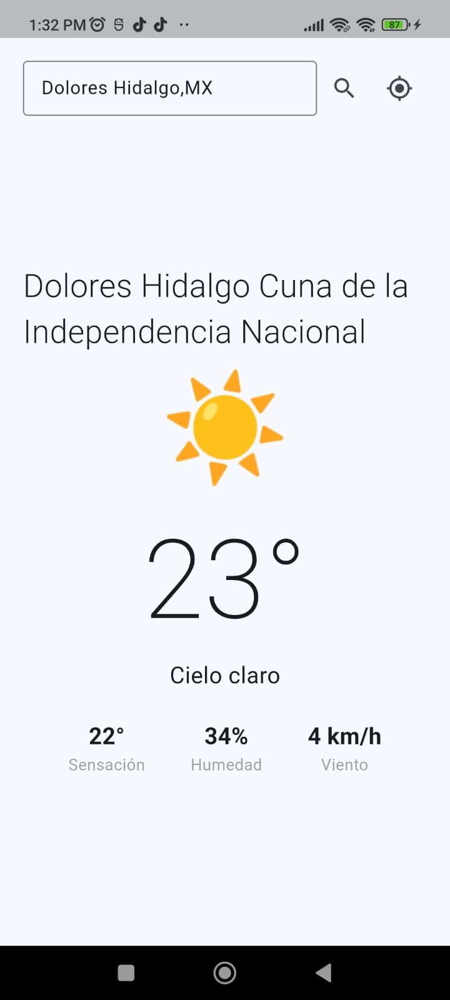

# Reto 3 · App del clima minimalista

App que consulta **OpenWeatherMap** y muestra el clima actual de tu ciudad (temperatura, sensación, humedad y viento). El *plus*: botón de ubicación que usa `geolocator` para detectar tu ubicación.

| | |
|---|---|
| **Alumna** | Yaneli Sánchez Cárdenas |
| **Grupo** | GTID244 |
| **Materia** | Desarrollo de Aplicaciones Móviles |
| **Docente** | Prof. Anastacio Rodríguez García |
| **Universidad** | UTNG |

## Estructura

```
clima_minimalista/
  lib/
    clima.dart          <- modelo Clima + formatos (24°, km/h, emoji)
    servicio_clima.dart <- peticiones y errores con mensajes claros
    ubicacion.dart      <- permiso y ubicación con geolocator
    main.dart           <- pantalla con FutureBuilder
  test/
    clima_test.dart     <- 12 pruebas (con MockClient, sin internet)
  secrets.json          <- tu clave (NO se sube a GitHub)
  secrets.json.example
```

## Clave de OpenWeatherMap

1. Crea una cuenta gratis en openweathermap.org y copia tu clave en **API keys**.
2. Pégala en `secrets.json`:
   ```json
   { "OWM_KEY": "tu_clave" }
   ```
3. Una clave nueva puede tardar un rato (hasta un par de horas) en activarse. Mientras, la app dice "Clave inválida".
4. `secrets.json` está en `.gitignore`: nunca lo subas.

## Cómo ejecutarlo

Abre la carpeta `clima_minimalista` en VS Code (**File > Open Folder**) y en la terminal:

```bash
flutter create .                # genera android/, ios/, web/ (no borra lo que ya existe)
del test\widget_test.dart       # (Windows) borra la prueba de ejemplo
flutter pub get
flutter test                    # 12 pruebas, sin internet → "All tests passed!"
flutter run --dart-define-from-file=secrets.json
```

### Permisos para el botón de ubicación (Android)

En `android/app/src/main/AndroidManifest.xml`, antes de `<application`:

```xml
<uses-permission android:name="android.permission.ACCESS_FINE_LOCATION"/>
<uses-permission android:name="android.permission.ACCESS_COARSE_LOCATION"/>
```

En Chrome, el navegador pide el permiso solo.

## Evidencias

**La app funcionando en el celular** (clima actual de Dolores Hidalgo con la API de OpenWeatherMap):



## Lo que practiqué

- Parámetros `units=metric` y `lang=es` para grados Celsius y textos en español.
- Formatear datos del clima (redondeo, mayúscula inicial, m/s a km/h).
- Manejar estados de carga y error (404 ciudad no encontrada, 401 clave inválida).
- Pedir permisos de ubicación con `geolocator`.
