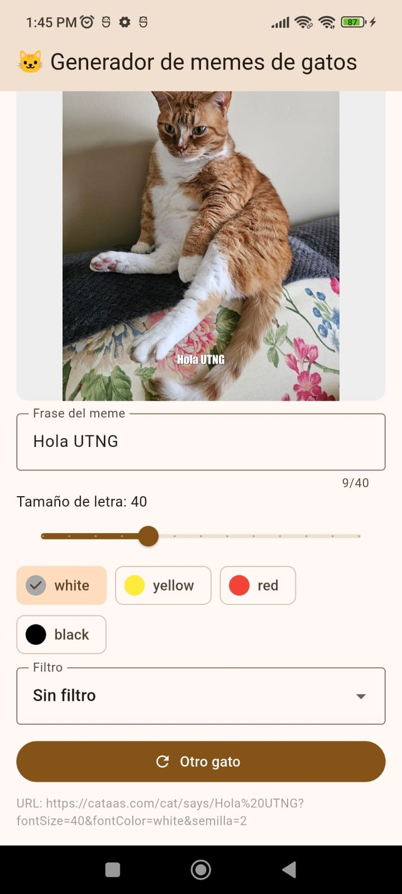

# Reto 2 · Generador de memes de gatos con filtros

App que usa la API de **Cataas (Cats as a Service)**: escribes una frase y aparece encima de la foto de un gato al azar. Puedes cambiar el tamaño y color de la letra y aplicar filtros.

| | |
|---|---|
| **Alumna** | Yaneli Sánchez Cárdenas |
| **Grupo** | GTID244 |
| **Materia** | Desarrollo de Aplicaciones Móviles |
| **Docente** | Prof. Anastacio Rodríguez García |
| **Universidad** | UTNG |

## Estructura

```
memes_gatos/
  lib/
    url_gato.dart     <- construye la URL dinámica de Cataas
    main.dart         <- TextField, slider, colores, filtros e Image.network
  test/
    url_gato_test.dart <- 8 pruebas
```

## Cómo cambia la URL

| Lo que eliges | URL |
|---|---|
| Sin texto | `https://cataas.com/cat` |
| Texto "Hola mundo" | `https://cataas.com/cat/says/Hola%20mundo?fontSize=40&fontColor=white` |
| Filtro blanco y negro | `...&filter=mono` |

El parámetro `semilla` cambia cada vez que tocas "Otro gato" para que Flutter no muestre la imagen guardada en caché. No necesita clave.

## Cómo ejecutarlo

Abre la carpeta `memes_gatos` en VS Code (**File > Open Folder**) y en la terminal:

```bash
flutter create .                # genera android/, ios/, web/ (no borra lo que ya existe)
del test\widget_test.dart       # (Windows) borra la prueba de ejemplo
flutter pub get
flutter test                    # 8 pruebas, sin internet → "All tests passed!"
flutter run
```

> En Chrome, si la imagen no carga, prueba en el emulador de Android. Si tu versión de Flutter marca error en la línea `webHtmlElementStrategy`, bórrala.

## Evidencias

**La app funcionando en el celular** (meme "Hola UTNG", letra 40, color blanco):



## Lo que practiqué

- Construir una URL dinámica con `Uri.https` (codifica espacios y acentos).
- `setState` para que la imagen cambie al instante.
- `Image.network` con `loadingBuilder` y `errorBuilder`.
